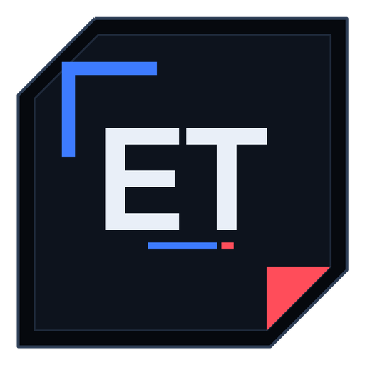

# EL TZY · AEGIS-M

**Offline mecha audio forge — v8.5.0**

> Rilis ini memfokuskan produk **sepenuhnya ke versi web**. APK tetap ada di repo
> sebagai eksperimen, tapi tidak dipasarkan dan tidak menerima fitur baru.

Slowed + reverb, nightcore, 8D orbit, club masters. Semua audio diproses **di
dalam perangkat** — tidak ada file yang diunggah, tidak ada telemetry, dan satu-
satunya panggilan jaringan adalah pemeriksaan lisensi dan probe kesehatan.

<p align="center">
  
</p>

---

## Kenapa v8?

Versi sebelumnya dibangun di Flutter. v8 dibangun ulang total di atas stack web modern supaya satu basis kode yang sama bisa jalan sebagai:

- **PWA** yang bisa di-install di Android/iOS/desktop,
- **APK Android** native (Capacitor 8) yang dibangun otomatis oleh GitHub Actions,
- dan tetap 100% offline — DSP-nya ditulis sendiri dalam TypeScript, bukan shell ke FFmpeg.

Tidak ada lagi ZIP, tidak ada bot build, tidak ada upload ke server.

---

## Fitur

| Area | Detail |
| --- | --- |
| **Time** | 0.50×–2.00×. Mode **RETRO** mengikat pitch ke tempo (tape), mode **MODERN** memakai WSOLA sehingga pitch tetap. |
| **Space** | Reverb FDN 8-line (hall / plate / chamber / cathedral), pre-delay, RT60 sampai 6 detik, damping. |
| **Orbit** | 8D rotation 0.02–0.50 Hz dengan kompensasi level dan width control. |
| **Tone** | Bass shelf, sub 55 Hz, clarity cut 680 Hz, presence 2.8 kHz, air 8 kHz, low-pass. |
| **Dynamics** | Saturasi tape, mono bass <120 Hz, de-esser, fade in/out. |
| **Repair** | Denoise STFT (1024/256, Wiener mask) dan Voice Focus. |
| **Master** | Target −16 / −14 / −11 / −9 LUFS atau bypass, trim gain **statis**, limiter true-peak −1.2 dBTP. |
| **Export** | MP3 128–320 kbps, WAV 16/24/32-float, FLAC 24-bit lossless. |
| **Preset** | 14 loadout tervalidasi (lihat di bawah). |
| **UI** | Tiga mode tampilan: **AUTO** (ikut tema sistem), **ARMOR** (putih), **COCKPIT** (hitam). Aksen cobalt/crimson/amber. |
| **Layout** | Fluid dari 320 px sampai 1440 px: tipografi `clamp()`, container query, safe-area notch, mode landscape, dock aksi di HP, nav pill di desktop. |

### Motion system

Semua animasi dijalankan di compositor (`transform` / `opacity`), tidak ada layout thrash, dan semuanya berhenti saat Reduce Motion aktif atau OS memintanya.

| Lapisan | Detail |
| --- | --- |
| **Kinetic heading** | Judul layar dipecah per huruf, masuk dengan rotasi 3D + blur → tajam, delay 22 ms per karakter. `aria-label` tetap satu supaya screen reader tidak mengeja. |
| **Scroll-driven** | `animation-timeline: view()` membuat setiap plate naik dan fokus saat masuk viewport — digerakkan posisi scroll, bukan JS. Fallback IntersectionObserver untuk browser lama. |
| **Number tweening** | LUFS, true peak, trim, persentase dock, dan sel master dianimasikan dari nilai yang sedang tampil, bukan dari nol. |
| **Text decode** | Nama preset dan status export di-resolve dari glyph acak ala HUD. |
| **Ripple + magnet** | Ripple radial mengikuti titik tap; tombol utama (FORGE, dock, primary) sedikit tertarik ke kursor. Touch device otomatis dilewati. |
| **Tilt + spotlight** | Kartu preset miring 5–6° mengikuti kursor dengan sorotan radial; plate punya spotlight via `@property --spot`. |
| **Spark burst** | Ledakan pecahan cobalt/crimson/putih saat export selesai, di kanvas terpisah yang langsung berhenti ketika partikel habis. |
| **Live chrome** | Progress bar scroll di bawah header, header memadat saat scroll, indikator tab meluncur dengan spring, aurora parallax. |
| **State motion** | Stage pip memantul berurutan, tag chain pop-in, baris pipeline slide, kartu arsenal cascade, progress meter bergaris berjalan, meter LUFS mengalir. |

### Antarmuka adaptif

- **Satu stylesheet, semua layar.** Ukuran huruf, jarak, dan target sentuh memakai `clamp()` + `dvh` + `env(safe-area-inset-*)`, jadi tidak ada breakpoint JS yang bisa meleset.
- **Dock aksi mobile.** Di bawah 900 px, tombol FORGE menempel di atas navigasi lengkap dengan cincin progres, jadi tidak perlu scroll ke panel master.
- **Desktop.** Navigasi berubah jadi pill mengambang, deck jadi dua kolom, lab tiga kolom.
- **Landscape.** Header, judul, dan waveform memendek otomatis; konten tetap terbaca di layar 390 px tinggi.
- **Gerak.** View Transitions API untuk pindah layar, reveal-on-scroll, dan semua animasi dimatikan otomatis saat `prefers-reduced-motion` atau toggle Reduce Motion aktif.
- **Tema otomatis.** Mode AUTO mengikuti `prefers-color-scheme` secara live, termasuk `<meta name="theme-color">` dan status bar Android.
- **Aksesibilitas.** Skip link, `role="tabpanel"` + panah kiri/kanan di navigasi, target sentuh ≥44 px, `aria-live` untuk progres, dan kontras tinggi via `prefers-contrast`.

### Preset

`night_shift` · `neon_nightcore` · `deep_orbit` · `void_drift` · `bass_forge` · `orbit_8d` · `phonk_protocol` · `liquid_drum` · `submerged` · `glass_cathedral` · `tape_memory` · `signal_clean` · `club_ready` · `mecha_protocol`

Setiap preset diuji: mendarat di target loudness ±1.2 LU, true peak ≤ −1.0 dBFS, tanpa NaN/Inf, dan tidak pernah menyentuh 0 dBFS.

---

## Arsitektur

```
src/
├─ dsp/            # engine murni, tanpa DOM. Semua fungsi (Stereo) => Stereo @48 kHz
│  ├─ buffer.ts    # Stereo { left, right, sampleRate }, gain, concat, sanitize
│  ├─ biquad.ts    # RBJ biquad, direct-form I, state per kanal
│  ├─ resample.ts  # Catmull-Rom varispeed + WSOLA time-stretch
│  ├─ fft.ts       # radix-2 complex FFT untuk denoise
│  ├─ denoise.ts   # STFT Wiener mask + voice focus
│  ├─ reverb.ts    # FDN 8-line, Hadamard feedback, RT60 → gain
│  ├─ dynamics.ts  # saturasi, width, mono bass, de-ess, fade, 8D
│  ├─ limiter.ts   # look-ahead brickwall + true-peak 4× Catmull
│  ├─ loudness.ts  # BS.1770-4 (K-weighting, gating) + true peak
│  └─ engine.ts    # render(): satu-satunya pipeline yang dipakai preview & export
├─ model/          # EditSettings, AppSettings, 14 preset
├─ io/             # decode, encode (WAV/FLAC/MP3), storage, WebAudio player
├─ state/          # store observabel + forge (preview/export) + session (tier)
├─ workers/        # render di Web Worker supaya UI tidak freeze
├─ ui/             # 4 layar publik + konsol #/control + account sheet + komponen
└─ styles/         # design system mecha (tokens, primitives, controls, layout)

api/               # Vercel functions (Node, ESM) — tanpa database
├─ _lib/auth.js    # HMAC sesi & lisensi, cookie httpOnly, rate limit
├─ auth.js         # GET/POST/DELETE sesi  (kunci lisensi atau kata sandi admin)
├─ license.js      # POST generator kunci    (admin only)
├─ health.js       # GET probe publik        (commit, region, uptime)
└─ csp-report.js   # POST kolektor CSP + GET admin (ring buffer 50)
```

**Kontrak inti:** preview dan export memakai `engine.render()` yang sama. Preview hanya memotong 24 detik pertama (dengan trim yang sama), jadi yang kamu dengar adalah hasil final, bukan simulasi.

**Urutan DSP:**

```
HP 24 Hz → repair → trim → normalise −0.5 dBFS → speed → fade
→ tone (bass/sub/clarity/presence/air/LP) → width → 8D → reverb
→ warmth → mono bass → de-ess → gain statis → limiter (−1.2 dBTP)
```

Tidak ada loudness normalisation dinamis. Selisih 12 dB antara bagian keras dan pelan tetap 12 dB setelah render.

---

## Menjalankan

```bash
npm install
npm run dev        # http://localhost:5173
npm test           # 154 tes: DSP, engine, encoder, UI (jsdom), motion, audit responsive, tier, auth, konsol
npm run typecheck
npm run build      # bundle produksi di dist/
npm run icons      # regenerate ikon PWA + Android mipmaps
```

## Akses, lisensi, dan konsol

Akses memakai **kunci lisensi**, bukan email dan bukan database. Satu kunci
adalah string bertanda tangan HMAC-SHA256 yang bisa diverifikasi sendiri oleh
server; sesi adalah cookie `HttpOnly` bertanda tangan yang sama. Tidak ada tabel
user, tidak ada reset password, dan mencabut semua akses cukup dengan mengganti
`AEGIS_SECRET`.

```
AEGIS-PRO-7F3K-20271120-9K2M4Q
      │    │    └ tanggal  └ tanda tangan 6 karakter
      │    └ serial acak
      └ tier (pro / admin)
```

| | **FREE** | **PRO** — Rp 79.000 / tahun | **ADMIN** |
| --- | --- | --- | --- |
| Preset | 4 dari 14 | 14 tervalidasi | 14 |
| Format | MP3 320, WAV 16 | + WAV 24/32, FLAC | semua |
| Target | Bypass, −14 LUFS | −16…−9 LUFS | semua |
| Panjang export | ≤ 12 menit | tanpa batas | tanpa batas |
| Riwayat | 3 export | penuh | penuh |
| 8D orbit | — | ✓ | ✓ |
| Repair & voice focus | — | ✓ | ✓ |
| A/B memory | — | ✓ | ✓ |
| Konsol `#/control` | — | — | ✓ |

Yang dibatasi sengaja adalah **alur kerja**, bukan kualitas: rantai DSP penuh,
limiter, dan semua fader tetap bisa dipakai di FREE. Tidak ada watermark, tidak
ada output yang diperkecil, dan tidak ada data yang dikirim ke mana pun.

**Konsol operator** ada di `#/control` — tidak pernah muncul di navigasi, dan
terkunci kata sandi admin. Isinya: kesehatan deployment (commit, region,
uptime), probe header respons, feed pelanggaran CSP, dan generator kunci.

### Mendapatkan kunci

Kunci diterbitkan manual dari konsol `#/control` → tab LISENSI, lalu dikirim ke
pembeli. Tombol **CARA DAPAT KUNCI** di aplikasi membuka satu URL yang bisa
diganti kapan saja di `src/model/contact.ts` (default: issue GitHub dengan
template pesanan). Tidak ada payment gateway di dalam bundle — kalau nanti ada,
cukup ganti satu konstanta itu.

### Variabel lingkungan

| Nama | Wajib | Fungsi |
| --- | --- | --- |
| `AEGIS_SECRET` | produksi | Kunci HMAC untuk lisensi dan cookie sesi. Ganti = cabut semua sesi. |
| `AEGIS_ADMIN_PASSWORD` | untuk konsol | Kata sandi masuk `#/control`. Kosong = konsol terkunci permanen. |

Tanpa keduanya aplikasi tetap jalan penuh di tier FREE; yang hilang hanya
kemampuan menerbitkan kunci. Salin `.env.example` untuk pengembangan lokal dan
setel nilai yang sama di dashboard Vercel.

## Keamanan — dua target, dua model

Website dan APK **sengaja tidak disamakan**. Web menghadapi internet dan markup
asing; APK jalan offline tanpa server, jadi header HTTP tidak relevan di sana.
Detail lengkap: [SECURITY.md](SECURITY.md).

**Web (Vercel)** — CSP Level 3 (`default-src 'none'`, `script-src 'self'`,
`style-src 'self'`, `frame-ancestors 'none'`), Trusted Types enforced + DOMPurify,
SRI sha-384, COOP `same-origin` + COEP `credentialless`, HSTS preload,
Permissions-Policy menolak kamera/mikrofon/lokasi/USB/payment/ad-APIs,
service worker hanya same-origin GET, laporan CSP ke `/api/csp-report`.

**App (APK)** — tanpa server, jadi pertahanan pindah ke manifest:
`usesCleartextTraffic="false"` + `network_security_config.xml`, `allowBackup="false"`
+ `data_extraction_rules.xml` (cloud backup & device transfer ditolak),
`allowNavigation: []`, `webContentsDebuggingEnabled: false`,
permission berbahaya dihapus dari manifest (build gagal kalau ada),
hanya `MainActivity` boleh exported, dan **service worker tidak didaftarkan**.
Diterapkan oleh `tools/android-harden.mjs`, diuji 6 tes.

Indikator postur keamanan **tidak lagi tampil di UI publik**. Semuanya pindah ke
konsol operator `#/control` (tab SECURITY): probe header respons live, feed
pelanggaran CSP, dan status sesi. Pengunjung biasa hanya melihat produknya.

### Deploy ke Vercel

`vercel.json` sudah memuat semuanya: framework, build command, output directory,
header keamanan, cache policy, dan SPA rewrite. Import repo di Vercel, atau:

```bash
npm run build          # tsc + vite build + SRI signing
vercel deploy --prod   # dengan project link
```

### APK Android

APK dibangun oleh GitHub Actions (`.github/workflows/android.yml`) setiap push:

1. checkout → Node 22 → JDK 21
2. `npm ci` → typecheck → test → build
3. `cap add android` (sekali) → `cap sync android`
4. `./gradlew assembleDebug`
5. artifact **aegis-m-debug-apk**

Unduh dari tab **Actions** (artifact `aegis-m-debug-apk`), lalu sideload APK-nya. Build pertama sudah terverifikasi: **sukses, 2m34s, APK ~4 MB**. Untuk Play Store, tambahkan keystore sendiri dan pakai `assembleRelease`/bundle.

---

## Kualitas & batasan (jujur)

**Sudah terverifikasi:**

- Loudness meter cocok dengan referensi BS.1770: sine 997 Hz @ −20 dBFS → **−23.01 LUFS**.
- Limiter menahan true peak di **−1.2 dBTP** termasuk inter-sample peak (4× oversampling).
- 14 preset → target loudness, tanpa clipping.
- FLAC yang dihasilkan **didekode bersih oleh FFmpeg 7.0.2** (48 kHz, stereo, 24-bit, tag terbaca).
- 72 tes otomatis + build produksi 99 kB (main) + 163 kB (MP3 codec, dimuat saat butuh).

**Batasan yang disengaja:**

- **FLAC di sini lossless tapi tidak terkompresi** (verbatim subframes). Ukurannya mirip WAV; encoder FLAC terkompresi butuh ~200 kB wasm dan belum dipakai.
- **Target −9 LUFS** hanya tercapai pada materi yang crest factor-nya rendah (master klub memang begitu). Materi dinamis akan berhenti di level yang masih aman; engine tidak akan clipping untuk memaksa angka.
- Tidak ada codec neural, Demucs, Atmos/MPEG-H, atau HRTF. Ini forge, bukan DAW.
- Preview memakai WebAudio; di WebView lama yang tidak punya `decodeAudioData` untuk format tertentu, konversi dulu ke WAV/MP3.

---

## Lisensi aset

Font **Chakra Petch** dan **Share Tech Mono** dipakai di bawah SIL Open Font License; teks lisensi ada di `src/assets/fonts/`.
