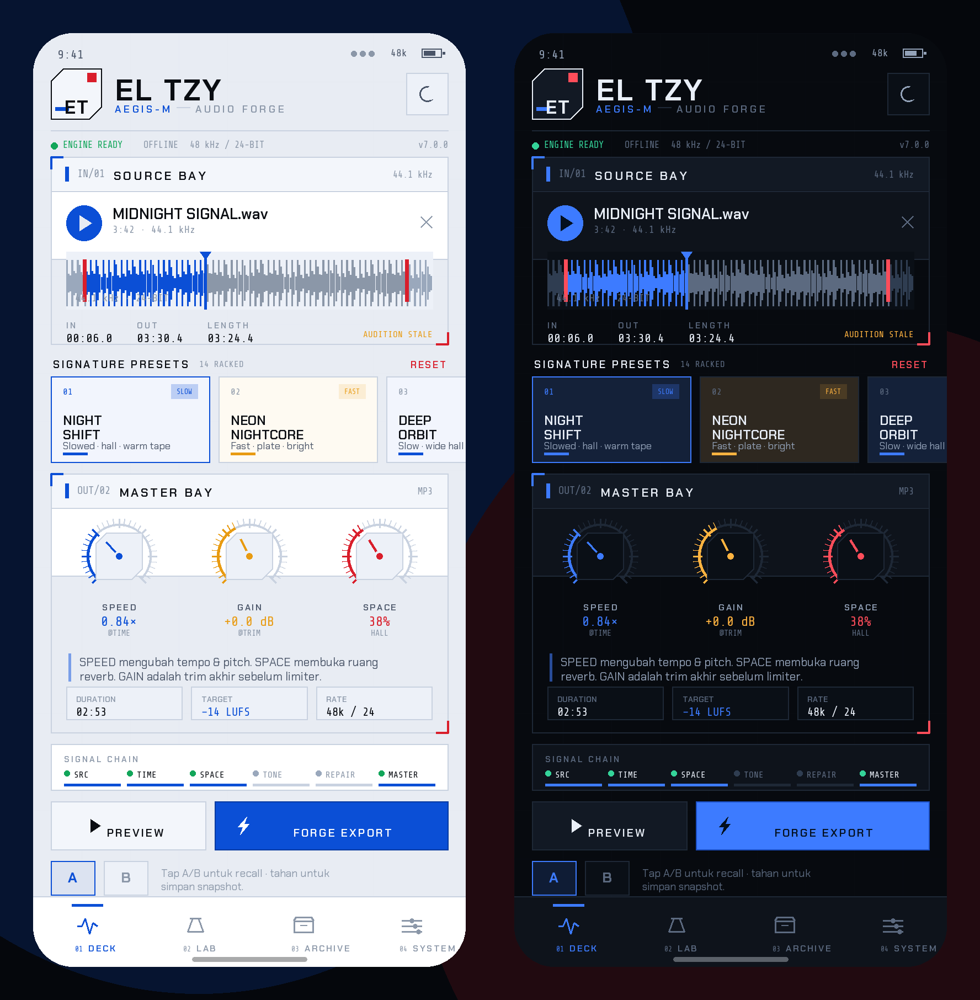

# EL TZY — AEGIS-M

> Mecha audio forge untuk Android. Slowed + reverb, 8D orbit, bass forge, repair,
> dan mastering loudness — **100% offline di HP**. FFmpeg 8 di dalam, tanpa upload,
> tanpa akun, tanpa tracking.

[](https://flutter.dev)
[](https://dart.dev)
[](#)
[](#)



<p align="center"><em>Armor White &nbsp;·&nbsp; Cockpit Black — rendered from the production design tokens.</em></p>

---

## Kenapa versi ini berbeda

Versi lama adalah aplikasi Material 3 bertema teal gelap dengan preset generik dan
rantai DSP yang menumpuk kompresor. Versi **7.0.0 "AEGIS-M"** adalah penulisan ulang
total:

| | v6 (lama) | v7 AEGIS-M |
|---|---|---|
| Bahasa | Dart + widget default | Dart 3.6, arsitektur `models → audio → state → screens` |
| UI | Material 3 teal, kartu membulat | Mecha cockpit: pelat chamfer, HUD grid, tipografi Chakra Petch + Share Tech Mono, **Armor White** & **Cockpit Black** |
| Preset | 8 preset tanpa kurasi | **14 preset terukur** — tiap preset diuji LUFS/true-peak |
| Loudness | `loudnorm` (pump) | **satu gain statis** hasil pengukuran dua tahap |
| Reverb | `aecho` acak | reverb matriks 10–20 tap, decorrelated L/R, per-ruang (hall/plate/chamber/cathedral) |
| 8D | `apulsator` tanpa kompensasi | kompensasi level dari filter (`level_out`), bukan volume eksternal |
| Export | 1 format | MP3/OGG/M4A/OPUS/FLAC/ALAC/WAV16/24/32, 48 kHz stereo, dither triangular |
| Metadata | tidak ada | provenance SHA-256 + preset + target + trim di tag audio |
| Rahasia | — | **interactive prototype** di `preview/` (buka di browser) |

---

## Fitur

### Deck
- **Source Bay** — file picker SAF (tanpa izin storage), probe otomatis, waveform
  interaktif dengan bracket trim dan playhead.
- **14 Signature Presets** — dari *Night Shift* sampai *Mecha Protocol*.
- **Master Bay** — tiga macro knob (Speed / Gain / Space), readout durasi target.
- **A/B snapshot** — simpan dan recall dua setelan.
- **Audition** — render 20 detik melalui rantai yang sama persis dengan export
  (bukan preview kasar), MP3 192 kbps.

### Laboratory (6 modul collapsible)
1. **TIME** — trim, fade in/out, speed 0.5–1.5×, mode `RETRO` (pitch ikut) / `MODERN` (pitch tetap).
2. **SPACE** — reverb 4 ruang (level/room/damp) + 8D orbit (rate/depth/width).
3. **TONE** — bass, bass freq, sub, clarity, presence, air, low-pass.
4. **CHARACTER** — warmth (tanh saturation), de-esser, mono bass, oversample 96 kHz.
5. **REPAIR** — spectral denoise (afftdn) dan voice isolation (RNNoise) dengan
   peringatan khusus musik.
6. **OUTPUT** — format, bitrate, loudness target, normalize input, turbo analysis.

### Archive
Riwayat ekspor on-device: format, durasi, ukuran, LUFS, hash, share, hapus.

### System
Finish (Armor/Cockpit), reduce motion, haptics, default format/loudness, turbo,
save destination (app vault / device / SAF folder), dan info build.

---

## Arsitektur

```
lib/
├─ main.dart                 # boot, tema, root
├─ app/
│  ├─ app_state.dart         # AppState (ChangeNotifier) + AppScope
│  └─ root_shell.dart        # 4 tab + ForgeScope
├─ core/
│  ├─ palette.dart           # MechaColors, Corners, chamferPath, ChamferClipper
│  ├─ typography.dart        # T.hero/title/label/body/metric
│  ├─ theme.dart             # ThemeData tanpa Material default
│  └─ format.dart            # fmtTime / fmtBytes / fmtDb / fmtLufs / fmtRate
├─ models/
│  ├─ edit_settings.dart     # 40+ parameter render + enum berlabel
│  ├─ preset.dart            # 14 preset kurasi
│  └─ app_settings.dart      # preferensi persisten
├─ audio/
│  ├─ graph_builder.dart     # filtergraph builder (1:1 port engine.py)
│  ├─ audio_engine.dart      # probe, measure, export, preview, waveform PCM
│  └─ waveform_service.dart  # peak buckets + cache
├─ state/
│  ├─ forge_controller.dart  # source → audition → export → history
│  └─ forge_scope.dart
├─ services/
│  ├─ storage_service.dart   # SAF bridge, save, share
│  ├─ history_service.dart   # JSON export log
│  └─ prefs.dart             # SharedPreferences
├─ screens/                  # deck, lab, archive, system
└─ widgets/                  # panel, rack, knob, slider, meter, waveform, HUD…
```

### Rantai sinyal (urutan wajib)

```
[0:a:0]
 → aresample (12 kHz saat turbo / rate sumber)
 → highpass 24 Hz
 → denoise (arnndn bila voiceMode, else afftdn)   ← lihat catatan di bawah
 → oversample 96 kHz (soxr)
 → atrim + asetpts
 → normalize input ke −0.5 dBFS (opsional)
 → speed  (retro: asetrate+soxr · modern: atempo)
 → fade in/out (di domain waktu setelah speed)
 → bass → sub → clarity (680 Hz) → presence (2.8 kHz) → air (8 kHz) → low-pass
 → extrastereo (width) → apulsator (8D, dengan level_out)
 → reverb send (dry/wet constant gain) atau anull
 → warmth parallel (asoftclip tanh)
 → mono bass (split 120 Hz)
 → de-esser (sidechain compress 6 kHz)
 → volume = trim statis
 → alimiter(0.89, latency, level=false)
 → aresample 48 kHz soxr precision 28 + triangular dither
 → aformat stereo
```

**Aturan yang tidak boleh diregresi** (semua sudah diuji terhadap FFmpeg 7/8 asli):

- Jangan pakai `loudnorm`, `asc=1`, atau glue `acompressor` — pecah di materi panas.
- `afir` rusak di FFmpeg 7/8 → reverb memakai `aecho` multi-tap.
- `asoftclip` hanya punya opsi `type=`.
- Output selalu **48 kHz stereo**, limiter **−1 dBFS true peak**.
- Pengukuran dijalankan **tanpa limiter** agar trim statis jujur.
- **RNNoise (`arnndn`) mematikan musik** (turun ~27 dB). Hanya untuk speech.
- Fade berada **sebelum** reverb, jadi ekor reverb tetap alami.
- `alac` ditulis ke `.m4a`, input selalu `[0:a:0]`, tanpa `adeclick`, tanpa `apad`.

---

## Build

Prasyarat: Flutter **3.27+** (Dart 3.6+), Android SDK dengan compileSdk 36, JDK 17.

```bash
flutter pub get
flutter build apk --release --split-per-abi
# output: build/app/outputs/flutter-apk/app-arm64-v8a-release.apk
```

Untuk bot ZIP→APK: arsipkan **isi repo** sehingga `pubspec.yaml` berada di **root ZIP**.

Konfigurasi Android: minSdk 24, targetSdk 36, AGP 8.11.1, Gradle 8.13, Kotlin 2.2.0,
`ffmpeg_kit_flutter_new_audio`, FileProvider `com.eltzy.app.fileprovider`,
`android:requestLegacyExternalStorage` aktif untuk perangkat lama.

---

## Preview UI (tanpa kompilasi)

`preview/index.html` adalah prototipe interaktif dari seluruh design system —
bisa dibuka langsung di browser, tanpa Flutter:

```bash
python3 -m http.server 4173 --directory preview
# http://localhost:4173
```

Semua warna, tipografi, chamfer, knob, export console, dan animasi di prototipe
mengikuti implementasi Dart di `lib/`.

---

## Lisensi & kredit

- Kode: lihat `LICENSE` bila tersedia di repo.
- Font: Chakra Petch & Share Tech Mono — SIL Open Font License 1.1.
- Model RNNoise: `assets/rnnoise/sh.rnnn` (BSD-3-Clause, Xiph.Org).
- FFmpeg: LGPL/GPL sesuai build `ffmpeg_kit_flutter_new_audio`.

Dibuat untuk produksi offline: **tidak ada upload, tidak ada akun, tidak ada tracking.**
